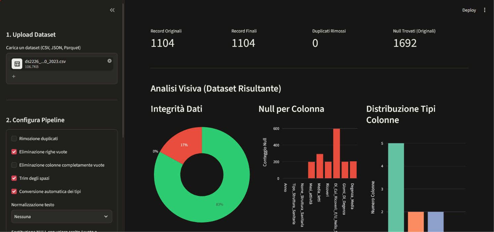

# 📊 CSV & Multi-format Data Quality Platform



Una piattaforma web interattiva end-to-end per il **Profiling, Data Quality Audit, Pulizia e Conversione di dataset** (CSV, JSON, Parquet), sviluppata in **Python** e **PySpark**, con un'interfaccia grafica moderna realizzata in **Streamlit** e **Plotly**.

Progettato come progetto portfolio per ruoli da **Junior Data Engineer**.

---

## 🚀 Caratteristiche Principali

### Ingestion Multi-Formato
- CSV, TXT, JSON, NDJSON, Parquet
- Auto-detect del delimitatore
- Normalizzazione header

### Audit & Profiling
- Percentuale dati validi vs mancanti
- Rilevamento NULL, duplicati e righe vuote
- Inferenza tipi dato
- Colonne incoerenti o duplicate

### Pipeline di Pulizia
- Rimozione duplicati
- Trim spazi
- Normalizzazione testo
- Conversioni ANSI-safe
- Gestione NULL

### Dashboard & KPI
- Metriche pre/post pulizia
- Grafici Plotly
- Distribuzione null e tipi dati

### Export
- CSV
- JSON
- Parquet
- SQL Dump

---

## 🛠️ Stack Tecnologico

- Python
- Apache PySpark 4.x
- Streamlit
- Plotly
- Pandas
- PyArrow
- Java 17
- Docker

---

## 📁 Struttura del Progetto

```text
csv-data-quality-platform/
├── src/
│   ├── components/
│   │   ├── dashboard.py
│   │   └── ui_helpers.py
│   ├── services/
│   │   ├── analyzer.py
│   │   ├── cleaner.py
│   │   ├── exporter.py
│   │   ├── ingestion.py
│   │   └── spark_session.py
│   ├── config.py
│   └── app.py
├── requirements.txt
├── Dockerfile
├── docker-compose.yml
└── README.md
```

---

## ⚙️ Prerequisiti

- Python 3.10+
- Java 17 JDK

```bash
python --version
java --version
```

---

## 📥 Installazione e Avvio Locale

### Clonazione

```bash
git clone https://github.com/tuo-username/csv-data-quality-platform.git
cd csv-data-quality-platform
```

### Ambiente virtuale

Windows:

```powershell
python -m venv venv
.\venv\Scripts\Activate.ps1
```

Linux/macOS:

```bash
python -m venv venv
source venv/bin/activate
```

### Dipendenze

```bash
pip install --upgrade pip
pip install -r requirements.txt
```

### Avvio

```bash
streamlit run src/app.py
```

Applicazione disponibile su:

```text
http://localhost:8501
```

---

## 🐳 Docker Deployment

```bash
docker build -t csv-data-quality-platform .
docker run -p 8501:8501 csv-data-quality-platform
```

---

## 🎯 Competenze Dimostrate

- Data Engineering
- Apache Spark
- ETL
- Data Quality
- Streamlit
- Docker
- SQL

---

## 👤 Autore

**Paolo Camedda**

*Junior Data Engineer | Python & Spark Developer*
